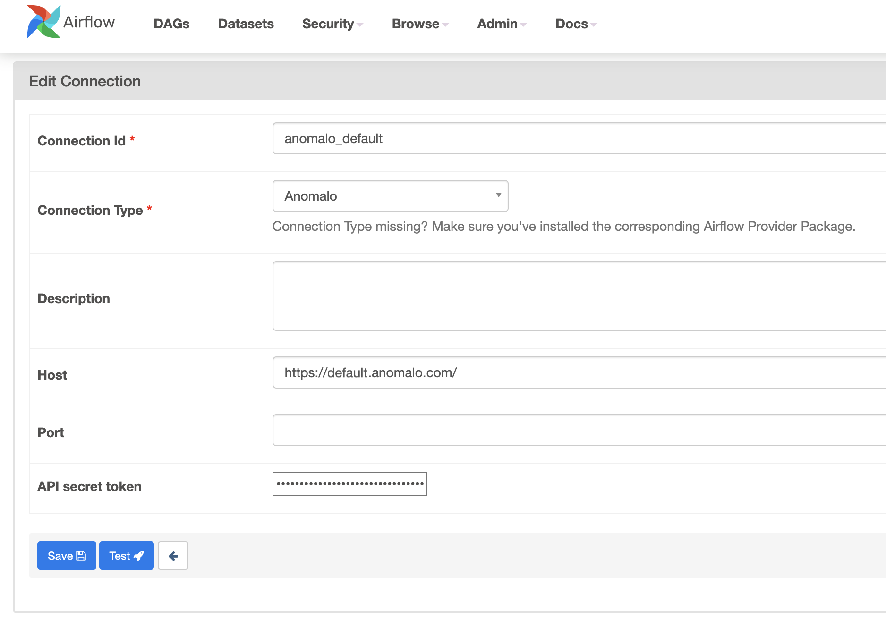
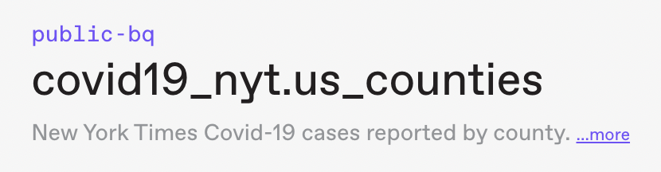

# Apache Airflow Provider for Anomalo
A set of native Airflow operators for [Anomalo](https://www.anomalo.com/)

### Requirements

Python 3.9 to 3.14
Airflow 2.8 or newer, including Airflow 3


### Installation


```
pip install apache-airflow-providers-anomalo
```
You can validate that it is correctly installed by running `airflow providers list` on the command line and seeing if `apache-airflow-providers-anomalo` is a listed providers package.

### Airflow Setup

From the airflow UI, go to Admin > Connections and hit the `+` button at the top to add a new connection.

From the "Connection Type" drop down, select "Anomalo".

Then fill in the fields for "Connection Id" (`anomalo-default` is the default connection id), "Host", and "API Secret Token".

If you define the connection outside the UI (Terraform, an `AIRFLOW_CONN_` environment variable or a secrets backend), you can put the API token in the connection's `password` instead of the `api_token` extra. The `api_token` extra is used when both are set.

## Usage

1. Obtain Anomalo table name from GUI. For example
   
   would be `public-bq.covid19_nyt.us_counties`

   Pass the full `warehouse.schema.table` name, including the warehouse. Recent versions of the `anomalo` client, which this provider allows from 0.3.0, reject a name without the warehouse, such as `covid19_nyt.us_counties`.

2. This package includes 3 different operators. You can find documentation for them on the operator code itself.
   1. Run checks Operator: `airflow.providers.anomalo.operators.anomalo.AnomaloRunCheckOperator`
   2. Job Sensor `airflow.providers.anomalo.sensors.anomalo.AnomaloJobCompleteSensor`
   3. Validate table checks: `airflow.providers.anomalo.operators.anomalo.AnomaloPassFailOperator`

3. `run_date` on `AnomaloRunCheckOperator` and `AnomaloPassFailOperator` accepts a `date` or a `YYYY-MM-DD` string and is templated, so you can tie it to the DAG run instead of the worker's clock. For example, `run_date="{{ ds }}"` for the run's logical date, or `run_date="{{ macros.ds_add(ds, -2) }}"` for a table whose data settles after two days. Left empty, it defaults to the day before the worker's current date.

4. See `example_anomalo.py` for usage example

## Releasing to PyPi

To release a new version to PyPi, you will need to

1. Configure your pypi token by running:
   ```poetry config pypi-token.pypi [token here]```
   The token can be found in the AWS secrets manager
2. Bump the version number in pyproject.toml. Make sure that this change is committed.
3. run
   ```poetry publish --build```

